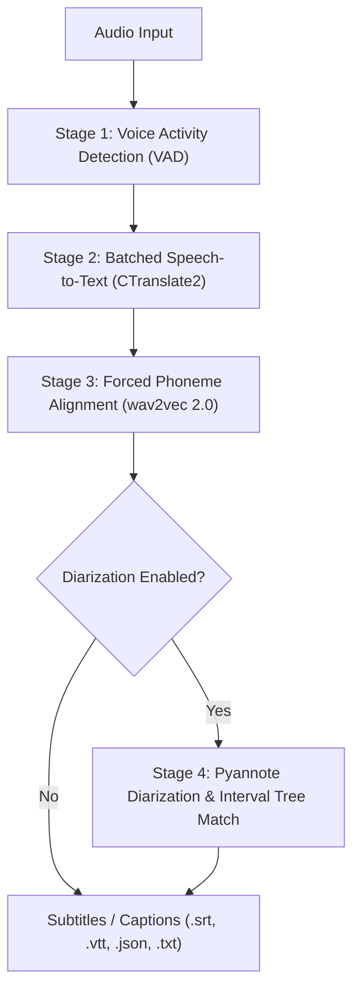

# Captioner

> High-performance automatic speech recognition, word-level phoneme alignment, and speaker diarization studio.

Captioner is an accelerated speech-to-text pipeline that provides real-time transcription with millisecond word-level timestamps and speaker diarization.

- ⚡️ **Batched Inference**: Up to 70x real-time transcription using faster-whisper (CTranslate2).
- 🎯 **Accurate Word-Level Timestamps**: Forced phoneme alignment using wav2vec2 CTC acoustic emissions.
- 👯‍♂️ **Speaker Diarization**: Multi-speaker labeling and attribution powered by Pyannote Audio.
- 🗣️ **VAD Preprocessing**: Voice Activity Detection strips silence and prevents hallucinations.
- ✂️ **Universal Media Clipper**: Frame-accurate audio/video clipping tool supporting all media formats, stream copy, exact re-encoding (0 glitches), burning subtitles directly into video, and sliced transcript generation.
- 🎙️ **Interactive Web Studio**: Full-stack web application with user authentication, SQLite database, audio waveform playback, real-time word karaoke highlighting, in-browser clip creator, and subtitle export (SRT, VTT, JSON, TXT, TSV).

---

## 🐳 Docker Quickstart (Single Command)

You can launch the entire Captioner Studio and 3D Media Clipper suite using a single command:

```bash
docker compose up --build -d
```

Or run the automated launcher script:
```bash
./run_docker.sh
```

- **Web Interface**: `http://localhost:8080`
- **Interactive API Docs**: `http://localhost:8080/docs`
- **Container Features**:
  - Automatically installs system FFmpeg, libsndfile, and uv-optimized Python environment.
  - Persistent volume storage for `./web/data` (database, media uploads, and exported clips).
  - Model weights cache volume (`captioner-cache`) prevents re-downloading Whisper/Pyannote models across container restarts.
  - Built-in container healthchecks via `/api/system/info`.
  - Seamless CPU execution or NVIDIA GPU acceleration via `nvidia-container-toolkit`.

To view container logs or stop:
```bash
docker compose logs -f
docker compose down
```

---

Captioner includes a full-featured web interface:

```bash
./start_studio.sh
```

Or run via Python:
```bash
python run_studio.py
```

The Web Studio is available at:
- **Web UI**: `http://localhost:8080`
- **Interactive API Documentation (Swagger)**: `http://localhost:8080/docs`

### Features
1. **User Authentication**: Secure user registration, login, and JWT session persistence.
2. **Interactive Upload Studio**: Drag-and-drop audio/video files, preset buttons (Fast, Balanced, Ultra Accurate), model selector (`tiny`, `base`, `small`, `medium`, `large-v2`, `large-v3`), and parameter customization.
3. **Word-Level Karaoke Player**: Audio player synchronized with millisecond-precision word highlighting. Click any word to jump audio playback to that exact timestamp.
4. **Speaker Diarization & Editing**: Edit transcripts, reassign speakers, and save changes directly to the database.
5. **Multi-Format Exporters**: Download subtitles in `.srt`, `.vtt`, `.json`, `.txt`, and `.tsv`.

---

## Python API Usage

```python
import captioner
from captioner.diarize import DiarizationPipeline, assign_word_speakers

device = "cuda" # or "cpu"
audio_file = "sample.wav"
batch_size = 16
compute_type = "float16" # or "int8" for CPU

# 1. Transcribe with batched model
model = captioner.load_model("base", device=device, compute_type=compute_type)
audio = captioner.load_audio(audio_file)
result = model.transcribe(audio, batch_size=batch_size)

# 2. Align word-level timestamps
model_a, metadata = captioner.load_align_model(language_code=result["language"], device=device)
result = captioner.align(result["segments"], model_a, metadata, audio, device)

# 3. Speaker Diarization (Optional)
diarize_model = DiarizationPipeline(token="YOUR_HF_TOKEN", device=device)
diarize_segments = diarize_model(audio)
result = assign_word_speakers(diarize_segments, result)

print(result["segments"])
```

---

## Command Line Interface (CLI)

Run transcription from the terminal:

```bash
captioner path/to/audio.wav --model base
```

With word-level timestamps and speaker diarization:

```bash
captioner path/to/audio.wav --model large-v2 --diarize --hf_token YOUR_HF_TOKEN
```

For CPU inference:

```bash
captioner path/to/audio.wav --device cpu --compute_type int8
```

---

## Universal Media Clipper

Captioner includes a robust, zero-flaw media clipping engine supporting all audio and video formats (MP4, MKV, WebM, AVI, MOV, MP3, WAV, FLAC, M4A, etc.).

### Command Line (`captioner-clip`)

```bash
# Frame-accurate clip with exact re-encoding
captioner-clip input.mp4 -s 00:01:15 -e 00:02:30 -o clip.mp4

# Instantaneous stream copy without re-encoding
captioner-clip input.mp4 -s 10.5 -d 30 -m fast -o clip.mp4

# Burn subtitles directly into the clipped video
captioner-clip input.mp4 -s 00:00:30 -e 00:01:00 --burn-subtitles --subtitles subs.srt -o clip.mp4

# Convert format (e.g. extract audio clip as MP3)
captioner-clip video.mp4 -s 00:05:00 -e 00:06:00 -f mp3 -o snippet.mp3

# Probe media information
captioner-clip input.mp4 --probe
```

### Python API

```python
import captioner

# Clip media with frame accuracy
output_file, metadata = captioner.clip_media(
    input_path="interview.mp4",
    start_time="00:01:20.500",
    end_time="00:02:45.000",
    burn_subtitles=True,
    subtitles_data=result,  # automatically slices transcript & burns onto video
    target_format="mp4",
    mode="exact",
)
print(f"Clipped duration: {metadata['duration']}s saved to {output_file}")
```

---

## Architecture



---

## License

MIT License. Copyright (c) 2026, Captioner Team.
# caption
